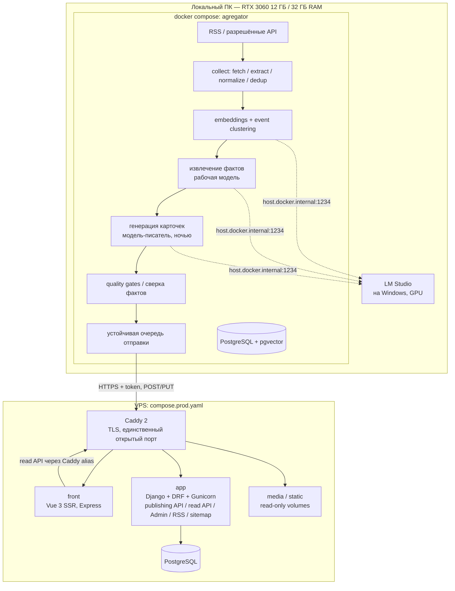

# IT / AI / Crypto News Intelligence — MVP Specification

**Version:** 0.5  
**Date:** 2026-10-24  
**Public website language:** English  
**Document language:** Russian  
**Architecture:** локальный intelligence pipeline → HTTPS publishing API → VPS (Django + DRF + PostgreSQL, Vue 3 SSR, Caddy) — стек image-gallery  
**Publishing mode:** automated, with mandatory quality gates  
**Local hardware:** RTX 3060 12 ГБ VRAM, 32 ГБ RAM, LM Studio (`http://127.0.0.1:1234/v1`)  
**Бюджет:** без платных API; расходы — VPS и домен

### Изменения в v0.5

- Стек приведён к проекту **image-gallery** (backend `image-gallery`, frontend `image-gallery-front`), который уже работает в production:
  - фронтенд — **Vue 3 + Vite с собственным SSR** (`entry-server.ts`, Express `server.js`) вместо Nuxt 3;
  - прокси — **Caddy 2** (автоматический TLS) вместо Nginx + certbot;
  - деплой — образы в **ghcr.io** из GitHub Actions, `deploy/deploy.sh <commit sha>` с откатом на любой коммит, `compose.prod.yaml`;
  - процесс — Conventional Commits + commitlint, semantic-release, Django test runner + coverage, настройки через pydantic-settings.
- Три репозитория, как в галерее (бэкенд и фронтенд раздельно) плюс локальный пайплайн (§10).
- Локальная БД пайплайна — **PostgreSQL (pgvector) в docker compose**, а не SQLite: уже так сделано.
- Отмечен фактический прогресс этапа 0 (§11).

### Изменения в v0.4

- Иллюстрации к публикациям: бесплатные стоковые фото по API (Pexels, запасной — Pixabay), подбор по абстрактным ключевым словам, хранение на сервере, подпись автора (§9.1).

### Сохранено из предыдущих версий

- Платные inference API не используются; генерация текстов — ночной партией.
- Этап 0 — прогон моделей на контрольном наборе до основной разработки.
- Механизм сверки фактов (§8), единая state machine статусов, маркировка AI-assisted.
- Аналитика и ревизии по развитию событий отложены; формат — карточка события + еженедельный дайджест.
- Ручная проверка (`REVIEW_REQUIRED`) — в Django Admin на VPS: материал приходит непубличным черновиком.

## 1. Цель продукта

Англоязычный тематический агрегатор событий:

- **IT:** разработка ПО, инфраструктура, cybersecurity, open source, hardware.
- **AI:** LLM, ML, generative AI, AI agents, research, hardware.
- **Crypto:** Bitcoin, Ethereum, блокчейн-разработка, DeFi, безопасность, регулирование.

Платформа автоматически получает публикации из разрешённых источников, устраняет повторы, объединяет статьи по событиям, извлекает проверяемые факты, пишет короткую англоязычную сводку события и публикует её со ссылками на все источники.

**Ключевая ценность:** одно событие → одна карточка → все источники рядом + короткая проверенная сводка. Не копировать чужие статьи, не выдавать рерайт за аналитику.

**Позиционирование:** не breaking news. Локальная машина работает не круглосуточно, поэтому сайт — дайджест событий с обновлением несколько раз в день.

## 2. Границы MVP

### Включено

1. Сбор RSS/Atom и данных из разрешённых публичных API (начально 20–30 источников).
2. Очистка, нормализация, дедупликация по URL и хешу.
3. Семантическая группировка публикаций по событиям.
4. Извлечение сущностей (компания, технология, продукт, токен) и фактических утверждений.
5. Генерация англоязычных карточек событий локальными моделями в LM Studio.
6. Еженедельный дайджест по каждой категории.
7. Обязательные автоматические проверки и сверка фактов перед публикацией.
8. Отправка на VPS через authenticated HTTPS API с устойчивой очередью и повторами.
9. Django Admin на VPS: очередь ручной проверки, правка и снятие публикаций.
10. Публичный сайт на Vue 3 SSR: главная, IT, AI, Crypto, событие, дайджест, сущности, поиск, RSS, sitemap.
11. Минимальные логи, метрики, бэкапы PostgreSQL.
12. Иллюстрация над каждой публикацией: стоковое фото по API (Pexels / Pixabay) с подписью автора (§9.1).

### Не включено на первом этапе

- Платные LLM / news API.
- Аналитические статьи «с собственными расчётами».
- Обновление опубликованных материалов по развитию событий (вместо этого — follow-up карточки). Ручные правки в Admin допускаются.
- LLM, embeddings и тяжёлая обработка на VPS.
- Kubernetes, микросервисы, Celery/Redis.
- Круглосуточная работа локальной машины.
- Торговые рекомендации, прогнозы цен криптовалют.
- Мультиязычность, аккаунты пользователей, комментарии, персонализация, мобильное приложение.
- Картинки из статей-источников (авторское право издателей) и собственная генерация иллюстраций (ComfyUI — после MVP).

## 3. Схема развёртывания



### Локальный контур (репозиторий `agregator`, уже создан)

- Django-проект без публичного веб-сервера: Django Admin только на `127.0.0.1:8001` (разметка, очередь, отладка), шаги пайплайна — management-команды (`collect`, `suggest_events`, `eval_run`, далее `cluster`, `extract`, `generate`, `validate`, `publish`).
- `compose.yaml`: `db` (pgvector/pgvector, порт `127.0.0.1:5433`, потому что 5432 занят галереей) + `app` (gunicorn + whitenoise для админки). LM Studio остаётся на Windows (ей нужна GPU), контейнер обращается к ней через `host.docker.internal:1234`.
- Команды можно запускать и с хоста (`uv run manage.py …`) — `.env` содержит значения для хоста, compose переопределяет `DB_HOST`/`DB_PORT`/`LM_STUDIO_BASE_URL` для контейнера.
- Python 3.14, uv, Django 6.1, настройки через pydantic-settings (как в галерее), тесты — Django test runner.
- Сбор и извлечение текста: `httpx`, `feedparser`, `trafilatura`. LLM — через OpenAI-совместимый API LM Studio (`openai` SDK), JSON-ответы валидируются `pydantic`. Embeddings — `nomic-embed-text-v1.5` в LM Studio, похожесть — numpy; позже хранение в pgvector.
- Расписание: Планировщик заданий Windows / APScheduler, вызывающий management-команды.
- Отправка: `OutboundJob` в локальной БД, retry с экспоненциальным backoff, идемпотентный `external_id`. При выключенном VPS или сети очередь догружается позже.

### Серверный контур (VPS, по образцу image-gallery)

| Сервис `compose.prod.yaml` | Назначение | Ориентир по RAM |
|---|---|---|
| `caddy` (caddy:2.x) | TLS (Let's Encrypt автоматически), маршрутизация, отдача media/static из read-only volumes, HTTP/3 | < 50 МБ |
| `front` (`ghcr.io/<owner>/agregator-front:<sha>`) | Vue 3 SSR на Express: публичный сайт, SEO-разметка | ~100–200 МБ |
| `app` (`ghcr.io/<owner>/agregator-backend:<sha>`) | Django + DRF + Gunicorn: publishing API, read API, Admin, RSS, sitemap | ~150–250 МБ |
| `db` (PostgreSQL 16) | публикации, источники, сущности, аудит | ~150–300 МБ |

- Наружу порты открывает **только Caddy** (Docker публикует порты в обход ufw, поэтому у `db` и `app` нет секции `ports:`).
- `front` при серверном рендере ходит в API через Caddy по сетевому alias домена API — ссылки на картинки сразу приходят абсолютными `https://…` (как в галерее).
- Логи контейнеров с ограничением размера (`driver: local`, `max-size`/`max-file`), как в галерее.
- DRF throttling со счётчиками в общем файловом кэше (одинаковые лимиты для всех воркеров gunicorn), `NUM_PROXIES = 1` (за Caddy).
- Минимальные требования: 1 vCPU, 2 ГБ RAM + swap, 20–40 ГБ SSD. 4 ГБ — комфортный запас.
- Кэш страниц: Express-сервер держит отрендеренный HTML в памяти с коротким TTL (микрокэш 1–5 минут для лент, дольше для страниц событий) и отдаёт `Cache-Control` — одно ядро выдерживает трафик, потому что страница не рендерится на каждый запрос. Кэш ответов на уровне Caddy в стандартной сборке отсутствует и в MVP не нужен.

**Важно:** сайт работает, даже когда локальный ПК выключен; прекращается только поступление новых материалов.

## 4. LM Studio: модели и ограничения железа

**Принцип:** скорость генерации не критична (15–20 карточек в день), поэтому задачи разделены по времени.

| Роль | Задачи | Модель | Замерено | Когда |
|---|---|---|---|---|
| Рабочая модель | классификация, извлечение фактов в JSON, «одно ли это событие», сверка утверждений | `qwen/qwen3.5-9b` (Q8) | JSON-ответ ~2 с; извлечение фактов из 2 статей ~70 с | днём, целиком на GPU |
| Модель-писатель | финальный английский текст карточки и дайджеста | `qwen/qwen3.8-27b` (dense, Q4_K_M, 16,5 ГБ; `--gpu 0.6`, контекст 16k, VRAM 11,4/12 ГБ) | ~4,4–5,1 ток/с; карточка 33 с (thinking `none`), 136 с (`low`); в прогоне 1 — 77 с/карточка, 2,2 ток/с (вероятно, 9B ещё была в памяти) | ночная партия |
| Embeddings | поиск похожих статей | `text-embedding-nomic-embed-text-v1.5` | 613 статей — около минуты | вместе с рабочей моделью |

Qwen3.8 27B требует движок LM Studio llama.cpp 2.64+ (на 2.14 не загружается: `missing tensor blk.64.ssm_conv1d.weight`). Если на этапе 0 рабочая модель пишет не хуже — используется одна модель на всё.

**Правила:**

- Одна модель в памяти одновременно. Модели, загруженные вручную (`lms load`), не выгружаются по TTL — пайплайн выгружает их сам (`lms unload`) между фазами.
- Загрузка писателя: `lms load qwen/qwen3.8-27b --context-length 16384 --gpu 0.6 -y`.
- **Память рабочей модели (замер 2026-10-24):** `qwen3.5-9b` Q8_0 при JIT-загрузке — 10,45 ГБ (веса Q8 ~9,5 ГБ + vision-энкодер `mmproj` BF16 ~0,9 ГБ), контекст 8192, 4 параллельных слота; VRAM 10,5/12 ГБ, процесс `llama-server` — 16,5 ГБ RAM (working set). Большая часть RAM — копия весов в оперативной памяти (настройка LM Studio «Keep model in memory») и отображение файла модели (mmap). Пайплайн будет грузить модель сам: `lms load … --context-length 8192 --parallel 1 --ttl 300` (`--ttl` — чтобы и ручная загрузка выгружалась по простою); «Keep model in memory» флагом CLI не задаётся — выключить в настройках загрузки модели в LM Studio (My Models → модель → Load); квант Q6_K/Q4_K_M того же 9B (~7,5 / ~5,7 ГБ) — кандидат на этапе 0, если качество не падает.
- Контекст 8–16k, а не максимальный: большой контекст съедает VRAM и вытесняет слои в RAM.
- **Thinking-модели (Qwen 3.5+) по умолчанию тратят весь `max_tokens` на рассуждения** и возвращают пустой ответ. LM Studio выключает их только параметром `reasoning_effort: "none"` (`/no_think` и `chat_template_kwargs` игнорируются). По умолчанию `none`, для писателя — `none` или `low` по итогам этапа 0.
- Последовательные запросы; `max_tokens`, тайм-ауты, повторы, валидация JSON по схеме (`response_format: json_schema`, работает в LM Studio). Повторная ошибка → материал не публикуется.
- Текст источников — недоверенный ввод (prompt injection): статьи в тегах `<article>`, системный промпт запрещает выполнять инструкции из них, вывод проверяется схемой.
- LLM — не fact-checker; проверка — код + узкие yes/no-вопросы (§8).

## 5. Конвейер обработки

1. **Discover:** скачать RSS/API-метаданные, соблюдать rate limits и лицензии.
2. **Normalize:** UTC, canonical URL (без tracking-параметров), заголовок, автор, источник, текст (trafilatura).
3. **Exact dedup:** canonical URL и content hash.
4. **Semantic retrieval:** кандидаты в событие — embeddings + окно по времени (3 дня) + разные источники; группы по complete linkage, чтобы одна слабая связь не склеивала две истории (уже реализовано в `suggest_events`, порог 0.85).
5. **Event assignment:** рабочая модель отвечает «одно ли это событие» для пар-кандидатов.
6. **Extract evidence:** утверждения, числа, даты, версии, суммы, цитаты — каждое с выдержкой и URL.
7. **Generate (ночью):** модель-писатель пишет карточку только из подтверждённых фактов (Markdown) и 2–3 абстрактных ключевых слова для иллюстрации.
8. **Validate:** схема, сверка фактов (§8), копирование, политика риска.
9. **Illustrate:** подбор стокового фото по ключевым словам (§9.1); в payload уходят ссылка на файл и данные автора, скачивает сервер.
10. **Publish:** `OutboundJob` → `POST /publications/`; `REVIEW_REQUIRED` уходит как непубличный черновик.
11. **Follow-up:** новые подтверждённые сведения → новая карточка со ссылкой на предыдущую (`previous_external_id`).

Ориентиры: до 200–500 входящих материалов/день, до 15–20 карточек/день, 1 дайджест на категорию в неделю. Верхние цели, не план.

## 6. Модель данных

### Локальная БД (PostgreSQL + pgvector, репозиторий `agregator`)

Уже есть:

| Модель | Ключевые поля / назначение |
|---|---|
| `sources.Source` | `name`, `slug`, `feed_url`, `site_url`, `category`, `trust_tier`, `license_policy`, `enabled`, `last_polled_at`, `last_error` |
| `sources.Article` | `source`, `canonical_url`, `title`, `author`, `published_at`, `summary`, `text`, `content_hash`, `status` (`new` / `extracted` / `extract_failed` / `duplicate`) |
| `evaluation.EvalEvent` / `EvalFact` | контрольный набор этапа 0: событие, его статьи, категория, `high_risk`, ключевые факты |
| `evaluation.EvalRun` / `EvalResult` | прогоны моделей: задача, модель, метрики (в т. ч. отдельно по `high_risk`), ответы, токены, время, ручная оценка |

Будут:

| Модель | Ключевые поля / назначение |
|---|---|
| `NewsEvent` | `headline`, `category`, `first_seen_at`, `last_seen_at`, `status`, `previous_event` |
| `EventSource` | `event`, `article`, `relation_score`, `is_independent` |
| `ArticleEmbedding` | `article`, `model`, `vector` (pgvector) |
| `Entity` / `EventEntity` | сущности события и их роль |
| `EvidenceClaim` / `ClaimEvidence` | утверждения, выдержки, `stance`, `verification_status` |
| `GeneratedDraft` | `event`, `type` (event / digest), `title`, `summary`, `body_md`, `image_keywords`, `quality_report`, `status`, `model_ids` |
| `ImageChoice` | `draft`, `provider` (pexels / pixabay), `provider_id`, `download_url`, `page_url`, `author`, `author_url`, `alt`, `width`, `height`; уникальность `provider + provider_id` |
| `OutboundJob` | `external_id`, `payload`, `attempts`, `next_retry_at`, `status`, `last_error` |

### Серверная БД (PostgreSQL, репозиторий `agregator-backend`)

| Модель | Ключевые поля / назначение |
|---|---|
| `Category` | IT, AI, Crypto |
| `Publication` | `external_id` (unique), `slug`, `category`, `type`, `title`, `summary`, `body_md`, `body_html` (санитизированный), `status` (`draft` / `review` / `published` / `withdrawn`), `revision`, `published_at`, `updated_at`, `previous` |
| `PublicationImage` | `publication` (1:1), `provider`, `provider_id`, `original` (ImageField), варианты WebP (cover 1200×675, card 600×338, thumb 320×180), `alt`, `author`, `author_url`, `page_url` |
| `PublicationRevision` | `publication`, `revision`, `body_md`, `quality_report`, `author` (pipeline / admin), `created_at` |
| `PublicationSource` | `publication`, `title`, `url`, `publisher`, `published_at`, `is_independent` |
| `Entity` / `PublicationEntity` | сущности и их публикации |
| `PublishAudit` | `external_id`, `request_id`, `action`, `result`, `created_at` |

Исходные тексты и embeddings остаются локально.

## 7. API

**Base URL:** `https://api.<domain>/` (отдельный поддомен API, как `api.artai.win` в галерее). OpenAPI-схема через drf-spectacular: `/api/schema/`, `/api/docs/`.

### Publishing API (закрытый, для локального пайплайна)

| Метод | Эндпоинт | Назначение |
|---|---|---|
| `POST` | `/publishing/publications` | Создать публикацию (идемпотентно по `external_id`) |
| `PUT` | `/publishing/publications/{external_id}` | Обновить с новой ревизией (`If-Match: <revision>`) |
| `GET` | `/publishing/publications/{external_id}` | Проверить состояние и ревизию |
| `GET` | `/health` | Доступность |

Авторизация — заголовок `X-Api-Key` (как ingest-эндпоинты галереи), ключ в `.env` сервера (`PUBLISHING_API_KEY`, `openssl rand -hex 32`); пустой ключ — публикация выключена (403).

```json
{
  "external_id": "event-2026-001245",
  "category": "ai",
  "type": "event",
  "status": "published",
  "title": "Example Corp releases Model X with 2x lower inference cost",
  "summary": "Example Corp announced Model X; independent benchmarks are pending.",
  "body_md": "Example Corp released **Model X** on October 22...",
  "sources": [
    {"title": "Model X announcement", "url": "https://example.org/blog/model-x", "publisher": "Example Corp", "is_independent": false}
  ],
  "entities": [{"slug": "example-corp", "name": "Example Corp", "type": "company"}],
  "previous_external_id": null,
  "image": {
    "provider": "pexels",
    "provider_id": "1234567",
    "download_url": "https://images.pexels.com/photos/1234567/pexels-photo-1234567.jpeg",
    "page_url": "https://www.pexels.com/photo/1234567/",
    "author": "Jane Doe",
    "author_url": "https://www.pexels.com/@janedoe",
    "alt": "Abstract server racks lit in blue"
  },
  "quality": {"status": "passed", "verified_claims": 6, "removed_claims": 1, "pipeline_version": "0.5", "models": ["qwen/qwen3.5-9b", "qwen/qwen3.8-27b"]}
}
```

Иллюстративный payload, не реальная новость.

**Контракт:**

- Валидация DRF serializer: типы, длины, размер payload. Пайплайн присылает Markdown; сервер сам рендерит в HTML и санитизирует по allowlist (`nh3`). HTML от клиента не принимается.
- `published_at` выставляет сервер; время события и время генерации хранятся отдельно.
- `quality.status` не считается доказательством: сервер дополнительно проверяет наличие источников и обязательных полей.
- Повторный `POST` с тем же `external_id` не создаёт дубль; изменения — только через `PUT` с `If-Match`.
- `status: "review"` → материал не виден публично, появляется в очереди Admin.
- `image` необязателен. Сервер скачивает `download_url` только с разрешённых хостов (`images.pexels.com`, `pixabay.com`) — защита от SSRF; проверяет тип и размер файла, делает варианты. Ошибка скачивания не блокирует публикацию: показывается картинка категории по умолчанию, скачивание повторяется позже.
- HTTPS, throttling, `PublishAudit` на каждый запрос.

### Public read API (для фронтенда)

| Метод | Эндпоинт | Назначение |
|---|---|---|
| `GET` | `/publications?category=&type=&page=` | Лента |
| `GET` | `/publications/{slug}` | Карточка события / дайджест |
| `GET` | `/entities/{slug}` | Сущность + её публикации |
| `GET` | `/search?q=` | Поиск (PostgreSQL full-text search) |

Только `published`, только чтение, throttling, кэширующие заголовки. CORS разрешает только домен сайта (`CORS_ALLOWED_ORIGINS`). Типы для фронтенда — из OpenAPI-схемы.

## 8. Quality gates и сверка фактов

### Механизм сверки (claim verification)

1. **Извлечение:** рабочая модель возвращает утверждения в JSON; каждое ссылается на `article_id` и дословную выдержку.
2. **Проверка выдержки кодом:** выдержка реально есть в тексте именно той статьи, на которую ссылается (нормализованное / fuzzy сравнение ≥ 0.9). Нет — утверждение отбрасывается. На этапе 0 это уже поймало ссылку модели не на ту статью.
3. **Детерминированная проверка чисел:** числа, проценты, даты, версии, суммы из утверждения должны встречаться в выдержке. Нормализация: разделители тысяч, символы валют, суффиксы масштаба (`256K` = `256,000`, `$1.5 billion` = `1500000000`). Реализовано в `verification/text_match.py`.
4. **Узкая проверка моделью + код поверх её ответа:** «Does the excerpt support the statement? supports / contradicts / unclear» с дословной цитатой. Проходит только `supports`, **и только если** цитата есть в статье, все числа утверждения есть в статье и все названия с цифрами (`CVE-2026-109618`, `PHP2Shell`, `K3.1`) есть в статье (`claim_problems` в `verification/text_match.py`). Без этого 9B подтверждает 13% ловушек (прогон 1): цитирует «$550 million» и соглашается с «$1101 million»; с проверкой — 0,4%.
5. **Сверка сгенерированного текста** (`verification/card_check.py`, сделано): карточка режется на заголовок, лид и предложения тела. Каждое предложение: код — числа (округление до ≥ 2 значащих цифр допустимо: «€3.25M» для €3,252,618) и названия с цифрами есть в фактах; рабочая модель — факты подтверждают смысл, с номерами фактов (`supports` без валидных номеров не засчитывается), отдельное правило «кто это сказал» (газета сообщила ≠ компания подтвердила). Не прошло предложение тела — вырезается (`trimmed`); заголовок или лид, вырезано больше трети тела или в теле осталось < 2 предложений — `REVIEW_REQUIRED`. ~14 с на карточку на 9B.
6. **Независимость источников:** перепечатки одного пресс-релиза и тексты с высокой похожестью — один источник (`is_independent = false`).

### Gates

| Проверка | Результат при ошибке |
|---|---|
| Источник разрешён, URL валиден | `BLOCKED` |
| JSON/схема, дата, категория корректны | `RETRY_PENDING` (≤ 2 повтора) → `BLOCKED` |
| Все факты в тексте подтверждены | вырезать; ключевой факт → `REVIEW_REQUIRED` |
| Нет выдуманных цитат и источников | `BLOCKED` |
| Нет копирования больших фрагментов (n-gram overlap ниже порога) | `RETRY_PENDING` → `BLOCKED` |
| Повышенный риск (взломы, обвинения и иски, штрафы и регулирование, цены криптоактивов) без ≥ 2 независимых источников | `REVIEW_REQUIRED` |
| Событие уже опубликовано | `MERGED` / follow-up |

### State machine (локально, `GeneratedDraft.status`)

`NEW` → `GENERATED` → (`RETRY_PENDING`) → `PUBLISHED` | `REVIEW_REQUIRED` | `BLOCKED` | `MERGED`

- `PUBLISHED` → отправка со `status: "published"`; `REVIEW_REQUIRED` → отправка со `status: "review"` (решение принимается в Django Admin на сервере).
- **Цены криптоактивов:** только прямая цитата из источника с указанием источника и времени.
- LLM не является источником фактов: любое существенное утверждение трассируется к оригиналу.

## 9. Публичный сайт (Vue 3 SSR) и SEO

Стек как в `image-gallery-front`: Vue 3, Vite, собственный SSR (`entry-server.ts` / `entry-client.ts`, Express `server.js`), vue-router, Pinia, Tailwind CSS 4 + daisyUI, TypeScript, vitest, oxlint + eslint, prettier. Локализация (vue-i18n) не нужна — сайт только на английском.

Маршруты:

```text
/
/it/  /ai/  /crypto/
/events/{slug}/
/digest/{category}/{year}-w{week}/
/entities/{slug}/
/search/
/about/  /methodology/  /editorial-policy/
/rss.xml  /{category}/rss.xml        → Django (django.contrib.syndication), маршрут в Caddy
/sitemap.xml  /news-sitemap.xml       → Django (django.contrib.sitemaps), маршрут в Caddy (как в галерее)
```

- Title, description, canonical, Open Graph и JSON-LD `NewsArticle` рендерятся на сервере в `entry-server` — поисковики и превью соцсетей получают готовый HTML.
- Микрокэш отрендеренных страниц в Express (§3), `Cache-Control` на ответах.
- Адаптивная вёрстка, тёмная тема (daisyUI).
- Страница события: иллюстрация, заголовок, сводка, текст, блок «Sources» со всеми источниками (с пометкой независимых), сущности, ссылка на предыдущее/следующее событие.
- **Маркировка:** каждая карточка помечена «AI-assisted summary» со ссылкой на `/methodology/`. Проверить применимость ст. 50 EU AI Act.
- На сайте только собственные сводки и короткие цитаты со ссылками на оригиналы.

**SEO-рамки:** RSS не означает разрешения на перепубликацию; автоматический контент не гарантирует индексацию. Ценность — группировка источников по событию и проверенная сводка, а не объём текста.

### 9.1. Иллюстрации

**Зачем:** Google Discover и превью в Google News показывают крупное изображение только при его наличии (ширина от 1200 px, `max-image-preview:large` в robots meta); без картинки материал там не появится. Плюс карточки в ленте и превью в соцсетях (Open Graph).

**Источник — бесплатные стоковые API:**

| Сервис | Роль | Хранение у себя | Атрибуция |
|---|---|---|---|
| Pexels API | основной | разрешено | указывать автора и Pexels |
| Pixabay API | запасной | разрешено (сервис сам просит скачивать к себе) | ссылка на Pixabay |
| Unsplash API | не используется | запрещено правилами API (только hotlink по их ссылке) | — |

Ключи бесплатные (регистрация). Лимиты и условия проверить в документации сервисов перед запуском: они меняются.

**Не использовать:** картинки из статей-источников (авторское право издателей; наличие в RSS не даёт права публикации), логотипы и фото реальных людей.

**Подбор (локальный пайплайн):**

1. Модель-писатель вместе с карточкой выдаёт 2–3 абстрактных запроса на английском без имён и брендов (`cybersecurity lock server`, `blockchain network abstract`).
2. Поиск в Pexels: `orientation=landscape`, ширина оригинала ≥ 1200 px. Нет результата → Pixabay → запасной запрос по категории (`technology`, `artificial intelligence`, `cryptocurrency`).
3. Из найденного берётся первое фото, которого ещё нет в `ImageChoice` (без повторов на сайте).
4. Нет ничего подходящего → картинка категории по умолчанию (своя, сделана один раз).
5. Ответы API кэшируются локально (запрос → результаты) — экономия лимитов.

**Сервер:** скачивает оригинал с разрешённого хоста, через Pillow делает WebP-варианты (cover 1200×675 для страницы и Open Graph, card 600×338 для ленты, thumb 320×180), кладёт в media — тот же механизм, что в image-gallery; Caddy отдаёт media из read-only volume. Над статьёй — cover с `alt`, под ним подпись `Photo: <автор> / Pexels` со ссылками на автора и страницу фото. В JSON-LD `NewsArticle.image` — URL cover.

**Позже (не MVP):** собственные абстрактные иллюстрации через ComfyUI ночной партией (после выгрузки LLM из VRAM), без людей, логотипов и текста, с пометкой «AI illustration».

## 10. Репозитории и структура

Три репозитория — как галерея (бэкенд и фронтенд раздельно), плюс локальный пайплайн, который никогда не попадает на сервер.

```text
agregator/                      # локальный пайплайн (PyCharm, уже есть)
├── config/                     # settings + app_settings (pydantic-settings)
├── sources/                    # Source, Article, collect, sync_sources
├── llm/                        # LMStudioClient (JSON по схеме, повторы, замеры), llm_check
├── verification/               # сверка цитат и чисел (§8)
├── evaluation/                 # этап 0: EvalEvent/Fact/Run/Result, eval_run, suggest_events
├── (events/, generation/, images/, publisher/ — следующие этапы)
├── docker/entrypoint.sh
├── Dockerfile, compose.yaml    # db (pgvector) + app (админка на 127.0.0.1:8001)
├── LOCAL.md                    # локальная шпаргалка с доступами (в .gitignore)
└── it_ai_crypto_news_mvp.md

agregator-backend/              # VPS: Django + DRF (по образцу image-gallery)
├── config/                     # settings, app_settings, drf.py
├── common/
├── publications/               # модели, admin (очередь review), сервисы картинок
├── publishing_api/             # X-Api-Key, идемпотентность, If-Match
├── public_api/                 # лента, событие, сущности, поиск
├── feeds/                      # RSS, sitemap, news sitemap
├── docker/entrypoint.sh, Dockerfile
├── compose.yaml                # dev
├── compose.prod.yaml           # caddy + front + app + db
├── deploy/                     # deploy.sh <sha>, backup.sh, Caddyfile
└── .github/workflows/ci.yml    # commitlint, тесты с Postgres, образ в ghcr

agregator-front/                # VPS: Vue 3 SSR (по образцу image-gallery-front)
├── src/ (views, components, composables, router, api.ts, entry-server.ts, entry-client.ts)
├── server.js                   # Express: SSR + микрокэш
├── Dockerfile, compose.yaml    # dev: сеть бэкенда
├── deploy/deploy.sh
└── .github/workflows/ci.yml
```

Контракт payload публикации описан один раз — в OpenAPI-схеме бэкенда (drf-spectacular) — и версионируется вместе с API; пайплайн валидирует отправляемые данные своей pydantic-моделью того же вида.

**Процесс во всех трёх репозиториях:** Conventional Commits (commitlint в CI), semantic-release (`fix`/`perf` → patch, `feat` → minor), изменения конфигурации, Docker и CI — только `build`/`ci`/`chore`. Деплой вручную: `bash deploy/deploy.sh <full commit sha>` — тот же скрипт откатывает на любой предыдущий образ.

## 11. Этапы реализации

| Этап | Результат | Грубая оценка | Статус |
|---|---|---|---|
| **0. Источники + прогон моделей** | источники, сборщик, контрольный набор, задачи прогона, выбор моделей | 3–4 дня | почти готов: остался прогон и выводы |
| 1. Backend core | `agregator-backend`: модели, publishing API, Admin, compose.prod, Caddy, CI, деплой на VPS | 3–5 дней | — |
| 2. Frontend core | `agregator-front`: лента, категории, страница события, SEO, микрокэш, CI | 4–6 дней | — |
| 3. Сквозной срез | RSS → событие → факты → карточка → API → страница на сайте | 3–4 дня | — |
| 4. Event clustering | embeddings в pgvector, кандидаты, «одно ли событие», сущности | 5–7 дней | основа есть (`suggest_events`) |
| 5. Evidence + verification | сверка фактов (§8), gates, очередь review | 7–10 дней | проверки цитат и чисел есть |
| 6. Hardening | расписание, retry, бэкапы, мониторинг, дайджесты, поиск, RSS/sitemap | 4–6 дней | — |
| 7. Иллюстрации | подбор фото (Pexels / Pixabay), WebP-варианты на сервере, подпись, OG/JSON-LD | 2–3 дня | — |

**Итого:** ориентировочно 31–45 рабочих дней. Этапы 1–2 можно делать параллельно с прогоном этапа 0. Настройка качества — постоянный процесс.

### Этап 0: источники и прогон моделей

**Зачем:** выбрать модели по реальным результатам на своих задачах и до основной разработки узнать, что вытягивает локальное железо.

Сделано:

1. **Источники:** 25 RSS-лент (`sources/data/sources.json`, `sync_sources`). Работают 24; VentureBeat отвечает 429 — отключить. Без полного текста: The Block (всегда), BleepingComputer и LWN (частично).
2. **Сборщик:** `collect` — 615 статей за первый запуск, полный текст через trafilatura, дедупликация по URL и хешу.
3. **Контрольный набор:** `suggest_events` (embeddings + complete linkage) предложил группы, неподходящие отброшены, смешанные разделены — **34 события, 88 статей, 254 ключевых факта**, 18 событий с `high_risk`. Каждое число в фактах проверено по выдержкам, которые видят модели.
4. **Задачи прогона** (`eval_run`):

| Задача | Метрика |
|---|---|
| `classify` — IT / AI / Crypto / other | accuracy, частые ошибки |
| `same_event` — пары статей | precision / recall / false_merges (ложное объединение хуже пропуска) |
| `extract` — факты в JSON с цитатами | **invented_rate** (выдуманные цитаты/числа, главная метрика), recall ключевых фактов |
| `verify` — supports / contradicts / unclear, с ловушками (изменённое число, чужая статья) | **false_support_rate** (должно быть ~0), true_support_rate |
| `write` — карточка по фактам | выдуманные числа + ручная оценка 1–5 в админке |

Все метрики считаются и отдельно по `high_risk`-событиям.

Осталось: исправления ниже; `write` на `qwen/qwen3.5-9b` и на 27B с thinking `low` — для сравнения с 27B `none`. Набор и задачи остаются регрессионным тестом при смене моделей или промптов.

#### Прогон 1 (2026-10-24, `qwen/qwen3.5-9b`)

| Задача | Результат | High-risk | Вывод |
|---|---|---|---|
| `classify` | accuracy 0.807 (88 статей), 1,6 с/статья | 0.756 | 12 из 17 ошибок — кибербезопасность → `crypto`: промпт путал криптовалюты с криптографией (в описании `crypto` было «crypto security»). Остальные 5 спорные (Meta Class C → `it`, SEC tokenization + super intelligence → `ai`) |
| `same_event` | precision 0.987, recall 0.963, 1 ложная склейка из 160 пар, 4,5 с/пара | precision 0.974, recall 0.949 | Модель подходит для склейки событий. 2 из 4 ошибок — битые тексты CoinDesk (модель права по тем данным), 1 ложная склейка — два материала одной истории PHP2Shell за соседние дни (спорная разметка) |
| `classify` (после исправления промпта) | **accuracy 0.932**, 1,6 с/статья | **0.978** | Осталось 6 ошибок, все спорные: 3 `ai → it`, 2 `crypto → it`, 1 `it → crypto` |
| `extract` | **0 выдуманных из 375 фактов** (34 события), 67 с/событие | 0 из 200 | Модель не выдумывает. Эвристика recall показывает 0.675, ручная проверка двух худших событий (0.25 и 0.33 по эвристике) дала ~0.6 и ~0.8: модель находит факты, но формулирует иначе. Модель находит и то, чего нет в эталоне (дата одобрения Meta Class C из Decrypt — верная) |
| `verify` (модель одна) | true_support 0.988, **false_support 0.134** | 0.985 / 0.132 | Модель подтверждает утверждения с изменённым числом, сама цитируя правильное число. Одной модели верить нельзя |
| `verify` (модель + код, §8 п. 4) | true_support 0.976, **false_support 0.004** (1 из 254) | 0.978 / 0.007 | Код отсекает 33 из 34 принятых ловушек. Теряет 3 верных факта: модель выдала пересказ за цитату — так и должно быть. Оставшаяся ловушка — утверждение без чисел против чужой статьи (риска для публикации нет: факты берутся только из своих статей) |
| `write` (`qwen/qwen3.8-27b`, thinking `none`) | **0 выдуманных чисел** в 34 карточках, ручная оценка **4.8** из 5, 77 с/карточка | 0 | Английский чистый, без воды, за рамки фактов не выходит. 1 смысловая ошибка: заголовок «…Ending Three-Day Streak» при факте «трёхдневная серия притоков принесла $1.07 млрд» (серия не закончилась). 2 «выдуманных числа» были округлениями (€3.25M, «over 10,000») — проверка исправлена |

**Выбор моделей по прогону 1:** рабочая — `qwen/qwen3.5-9b` (classify, same_event, extract, verify — только вместе с кодовой проверкой), писатель — `qwen/qwen3.8-27b` с thinking `none`. Смысловые ошибки писателя (как «серия закончилась») числами не ловятся — их ловит проверка предложений (§8 п. 5).

| `card_check` (`qwen/qwen3.5-9b`, 34 карточки 27B + те же с ловушкой) | Пропущено ложных | Зря вырезано верных | Статусы |
|---|---|---|---|
| прогон 13 | 1 из 36 (0.028): «Tether confirmed the deal» при факте «WSJ reported» | 0 из ~200 | карточки: 33 passed, 1 review (верно: «Ending Three-Day Streak»); ловушки: 32 trimmed, 1 review, 1 passed |
| прогон 14 (+ правило «кто это сказал») | **0 из 36** | **0** | карточки: 33 passed, 1 review; ловушки: 33 trimmed, 1 review |

Оговорка: ловушки (`evaluation/data/card_traps.json`, 34 шт.) написаны вручную, и правило добавлено после промаха на одной из них — 0 из 36 не гарантия на новых ошибках. Набор ловушек пополнять реальными ошибками писателя, найденными при ручной проверке.

#### Конвейер (сделано, приложение `pipeline`)

`uv run manage.py pipeline [--stage group|facts|write|check]` — новые статьи → события → факты → карточка → проверка → черновик (`Draft`: `ready` / `review` / `unchecked`), просмотр в админке (Pipeline → Drafts).
- **Склейка:** embeddings, событие берёт статью, только если она близка ко всем статьям события (≥ 0.8, окно 3 дня) и рабочая модель подтверждает «то же событие» с ближайшей.
- **Готовность:** ≥ 2 источника или 6 ч ожидания; за запуск — до 10 событий (сначала с большим числом источников).
- **Классификация события:** категория (`other` → пропуск) и `high_risk`.
- **Факты:** извлечение → код (цитата и числа в статье) → проверка моделью по абзацу цитаты + код поверх ответа. < 3 подтверждённых фактов — карточки нет.
- **Карточка:** писатель по подтверждённым фактам → проверка предложений (§8 п. 5) → `ready`, или `review` (заголовок/лид не подтверждён, вырезано много, high-risk с одним источником).
- **Модели** грузятся через `lms` по фазам (9B + embeddings → 27B → 9B), каждая фаза сохраняет результат — прерванный запуск продолжается следующим.
- Промпты живут в `pipeline/steps/`, задачи `evaluation/` берут их оттуда: прогон проверяет ровно то, что работает в конвейере.

**Первый запуск (3 события, 4–11 статей, 5 источников):** все 3 черновика `ready`. Bitcoin Core и ETF — чистые. В карточке PHP2Shell одно ложное предложение: «Threat actors attempted to deploy a Mirai botnet variant called Potassium, utilizing a new exploit that bypasses ASLR». По статьям попытки Mirai были *неудачными*, а обход ASLR — эксплойт исследователей VulnCheck (только для их клиентов), не атакующих. Каждая половина — подтверждённый факт, ложна только связка «utilizing». Цепочка ошибки: при извлечении из фактов выпали «кто» и «чем кончилось» («A new exploit bypasses ASLR» без VulnCheck, без «unsuccessfully»), писатель соединил два факта, проверка карточки проверяла части по отдельности. Исправлено:
- извлечение — оставлять в факте, кто сделал, кто говорит и чем кончилось (tried, failed, planned, alleged);
- писатель — не соединять факты причиной, целью, средством или порядком, которых нет в фактах. Прогон `write` 17: 34 карточки, 0 выдуманных чисел, грубых ошибок нет, факты почти не склеиваются.

Проверку карточки пробовали ужесточить под такие связки: правило в промпте, ловушки-связки в `card_traps.json`, код на слова причины, второй вопрос модели. Итог — 9B пропускала ~25% связок, второй вопрос резал почти все верные предложения, а правило в промпте добавило пропуск старой ловушки (Dune). **Всё откачено, проверка — как в прогоне 14** (0 пропусков из 36). Мелкие неточности (потерянное «apparently», сумма, отнесённая не к той группе) — допуск, не ошибка.

**Длина карточки (2026-10-24):** текст 150–250 слов, 3–4 абзаца (что случилось → подробности → предыстория и реакция → что дальше; мало фактов — короче, без воды). Извлечение — до 20 фактов (было 12), включая предысторию; бюджет текста статей 12 000 символов. Google не наказывает за длину: риск — «scaled content abuse» (массовый контент без ценности сверх источника) при любой длине. Ценность — сводка нескольких источников со ссылками, хронология продолжений, дайджесты, страница «как мы делаем новости».

#### Исправления по итогам прогона 1

1. **Промпт `classify`** (сделано в коде, нужен повторный прогон): `crypto` — только криптовалюты и блокчейны; взлом, утечка, уязвимость, сертификаты и шифрование — `it`, если не про криптовалюту.
2. **Сборщик: тизеры и мусор сайта в тексте** (сделано, `reextract` перекачал сохранённые статьи):
   - **CoinDesk отдаёт на один URL то статью (~700 КБ HTML), то страницу без тела (~620 КБ)** — версии меняются в течение минут. Тизер (текст короче 600 символов после чистки) сразу скачивается повторно; не помогло — статья `extract_failed`, и следующие `collect` в течение 24 ч пробуют её ещё (до 3 попыток, `Article.extract_attempts`). Тизер идёт в `summary`, если лента описания не дала.
   - **Мусор сайта в каждом тексте CoinDesk:** промо-блок («5-7% yield… TAM grows to $4B») и строка цен («BTC $81,282.50 Up 0.11 percent…») — чужие числа внутри статьи, на которые проверка чисел приняла бы выдуманный факт. Теперь тексты хранятся с абзацами; абзац, который повторяется в ≥ 3 других статьях источника, — шаблон сайта: вырезается и запоминается (`Source.boilerplate`), строки цен и повторы внутри текста вырезаются (`sources/services/cleanup.py`).
   - **Флаг источника `full_text`** (в админке и в `sources.json`): The Block отвечает нашему боту 403 (браузерному User-Agent — 200; выдавать себя за браузер не будем) — `full_text: false`, работает по описанию из ленты. LWN — 403 на материалы для подписчиков, BleepingComputer — частично.
   - **The Register сменил вёрстку** — trafilatura вместо статьи брала блок «похожие статьи» (после чистки — 0 символов у 45 из 50); **Ars Technica** — местами половину статьи. Запасной вариант: абзацы `<p>` страницы вне навигации, списков и подвалов; берутся, если после вырезания шаблонов сайта в них больше чем вдвое больше текста. На остальных 20 источниках trafilatura не хуже — остаётся основной.
   - Итог по 615 статьям: 560 с полным текстом, 53 без (The Block 19 — по решению, LWN 11 — для подписчиков, CoinDesk 12 — докачаются следующими `collect`, BleepingComputer 5, HN 5, DeepMind 1). Чужих чисел (промо, цены) в текстах не осталось.
   - Статьи контрольного набора перекачаны; числа всех 254 эталонных фактов перепроверены по новым текстам — все на месте. Тексты изменились (чище), поэтому прогон 1 с новыми текстами не сравним один к одному: следующий прогон моделей — уже на них.
3. **Разметка контрольного набора:** PHP2Shell разделён слишком дробно (руководство до патча и попытки атак за 4 дня — одна история); категории Meta Class C и SEC 2027 — пересмотреть (допустимы две категории).
4. **Проверка цитат давала ложные срабатывания** (исправлено, `eval_rescore` пересчитывает без вызова модели): `extract` пометил 9 фактов из 195 как выдуманные, все 9 — верные. Модель сокращает цитаты многоточием («Proposition 40 ... would level a 5% tax») и меняет вид кавычек (“horrifying” → 'horrifying'). Теперь кавычки при сравнении не учитываются, а цитата с многоточием проходит, если каждый её кусок дословно есть в статье и куски идут по порядку. После исправления — **0 выдуманных из 195** на первых 18 событиях.
5. **Recall в `extract` — грубая оценка** (совпадение чисел и половины слов с эталонным фактом): занижает примерно вдвое на перефразированных фактах (ручная проверка: 0.25 → ~0.6, 0.33 → ~0.8). Для сравнения моделей годится как относительная цифра на одном наборе; точнее — сопоставлять факты embeddings или моделью.
6. **`verify` без кода ненадёжен** (сделано): к ответу модели добавлена проверка `claim_problems` (цитата, числа, названия с цифрами), в метриках — обе цифры (`false_support_rate` и `model_false_support_rate`). Попутно: `4.40` и `4.4` теперь одно число, неразрывный дефис (`GPT‑6.1`) = обычный.
7. **Писатель: смысловые ошибки** (сделано): проверка каждого предложения карточки (§8 п. 5, задача `card_check`); округления чисел допустимы.
8. **Память LM Studio** (§4): загружать модели пайплайном с явными параметрами (контекст, параллельность, без копии весов в RAM) и замерять RAM/VRAM в прогоне.

## 12. Экономика

- **LLM:** $0 — только локальные модели; затраты — электричество и время ПК.
- **VPS:** рассматриваемый вариант — 1 dedicated core, 4 ГБ RAM, 80 ГБ SSD, $15/мес. Минимально достаточно 1 vCPU / 2 ГБ RAM (обычно дешевле); выделенное ядро для MVP не обязательно. Можно разместить рядом с галереей, если её сервер тянет ещё один стек.
- **Домен:** ~$10/год.
- **Иллюстрации:** $0 — бесплатные API Pexels / Pixabay; место на диске VPS: ~4 WebP-варианта на публикацию.
- **Образы:** ghcr.io — бесплатно для публичных репозиториев и в пределах лимитов для приватных.
- **Бэкапы:** `deploy/backup.sh` — ночной `pg_dump` на VPS + забор дампа на локальный ПК, без платных хранилищ.
- Масштабировать VPS только по фактическим метрикам CPU/RAM/трафика.

## 13. Acceptance criteria для первого публичного релиза

1. Этап 0 завершён, модели выбраны; в опубликованных карточках контрольного набора нет выдуманных фактов после сверки (§8).
2. Система опрашивает не менее 20 разрешённых источников и восстанавливается после временных ошибок.
3. Одинаковые ссылки/хеши не создают дубликаты; кластеризация проверена на размеченной выборке.
4. Каждое число, дата, имя и цитата в опубликованной карточке трассируется к выдержке из источника.
5. Невалидный JSON, неподтверждённые ключевые факты и повышенный риск блокируют автопубликацию (уходят в review).
6. Повторная отправка одного `external_id` не создаёт дубль.
7. При выключенном ПК сайт доступен; после включения очередь публикаций догружается.
8. На VPS нет LLM/GPU и тяжёлой обработки; сайт укладывается в ресурсы VPS под нагрузочным тестом.
9. Страницы имеют корректные metadata, JSON-LD, sitemap, RSS, источники и маркировку AI-assisted — в HTML от сервера, без выполнения JS.
10. Секреты не в репозитории; publishing API только по HTTPS с ключом; наружу открыт только Caddy.
11. Бэкап PostgreSQL работает, восстановление проверено.
12. У каждой публикации есть иллюстрация не уже 1200 px (стоковая или картинка категории) с `alt` и подписью автора; одно стоковое фото не повторяется на сайте; картинки из статей-источников не используются.
13. CI во всех репозиториях: commitlint и тесты зелёные, образы в ghcr, деплой и откат через `deploy.sh <sha>` проверены.

## 14. Открытые решения

- ~~GPU и RAM~~ — RTX 3060 12 ГБ, 32 ГБ RAM.
- ~~Формат сайта и стек~~ — стек image-gallery: Django + DRF + PostgreSQL, Vue 3 SSR, Caddy, ghcr + deploy.sh.
- ~~Иллюстрации~~ — стоковые фото Pexels / Pixabay (§9.1); нужны бесплатные API-ключи. ComfyUI — после MVP.
- Модель-писатель и режим thinking — по итогам прогона этапа 0.
- VPS: отдельный ($15 / 4 ГБ dedicated или дешевле 2 ГБ shared) или рядом с галереей.
- Домен.
- Расписание ПК: часы для дневного извлечения и ночной генерации.
- Проверка условий использования источников (сейчас у всех `license_policy = unverified`).

---

**Архитектурное решение:** локальный пайплайн (Django + PostgreSQL в docker compose) + LM Studio (рабочая модель днём, писатель ночью) → сверка фактов → устойчивая очередь → HTTPS publishing API → Django + DRF + PostgreSQL и Vue 3 SSR за Caddy на VPS, деплой образами из ghcr — как image-gallery. Приоритеты: нулевые расходы на inference, трассируемые факты, сайт не зависит от включённого ПК.
